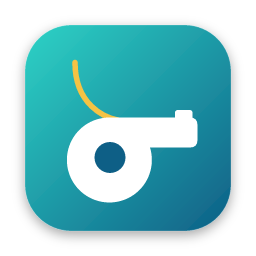
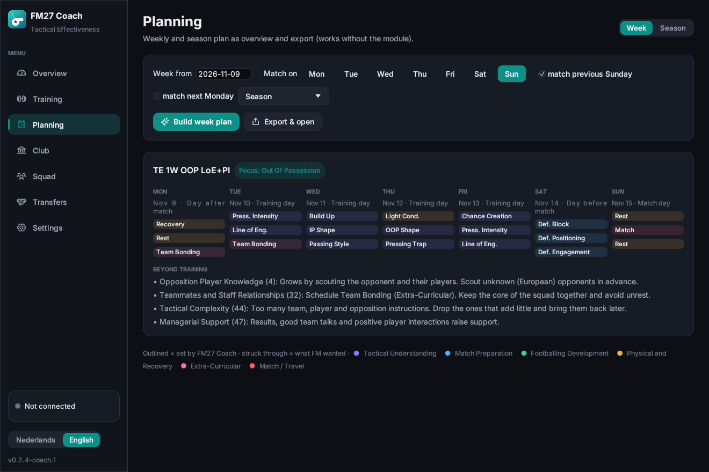
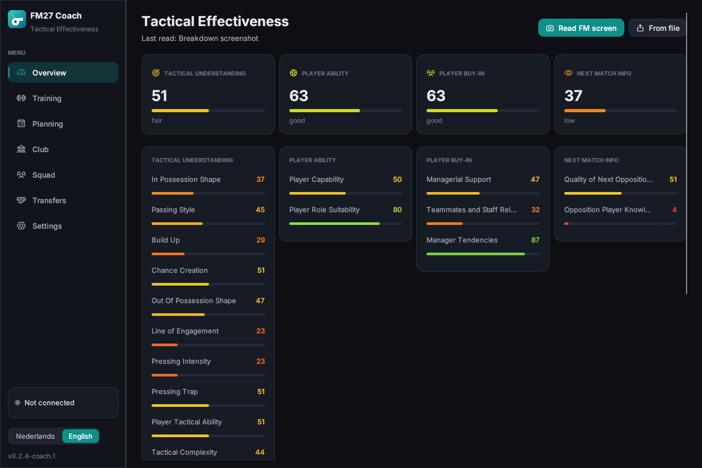

<p align="center">
  
</p>

<h1 align="center">FM27 Coach</h1>

<p align="center">
  <strong>Read your Tactical Effectiveness, let the app train your weakest areas,<br>
  and manage your club live, for Football Manager 27.</strong>
</p>

<p align="center">
  
  
  
  
</p>

<p align="center">
  <em>FM27 Coach is based on <a href="https://github.com/SemHiel2003/fm27-trainer">FM27 Trainer</a> by SemHiel2003 (MIT licence).</em>
</p>

<p align="center">
  <a href="README.nl.md">Nederlands</a> ·
  <a href="#features">Features</a> ·
  <a href="#install">Install</a> ·
  <a href="#how-it-works">How it works</a> ·
  <a href="docs/TECHNICAL.md">Technical notes</a>
</p>

<p align="center">
  
</p>

---

FM27 introduced **Tactical Effectiveness**: four areas (Tactical Understanding, Player Ability, Player Buy-In,
Next Match Info) and 17 key factors that all have to go up through training and management. FM27 Coach
reads those values from your game, works out a training plan aimed at your weakest areas, and writes it
straight into FM's training calendar, week after week.

## Features

**Read Tactical Effectiveness.** Open the *Breakdown* in FM and press *Read FM screen*. The app captures the
window, reads the labels with on-device OCR and measures all 17 pie gauges and 4 bars.

<p align="center"></p>

**Automatic training, straight into FM.** *Apply training in FM* plans every upcoming week around your real
fixtures and writes the sessions into FM's own calendar. The rhythm comes from Sports Interactive's own presets:
recovery after a match, match preparation the day before, conditioning in pre-season. The tactical slots go to
your weakest areas. Match and travel days are left to FM, and nothing on or before today is touched.
FM's assistant re-plans the next one or two weeks every week (and whenever fixtures change), so
*Keep training on plan automatically* checks every few seconds while the app is open and puts any change
back. The activity log shows exactly what FM wanted and what was restored.

**Club tools.** Set the transfer and wage budget, heal injuries, lift suspensions, and bring morale back to the
top. Every change can be undone, and it only sticks once you save in FM.

**Transfers.** Sell a player straight to any club, or buy one: pick a club, pick a player from its first team,
set the fee and wage, check, and he is in your squad; the money moves between the two clubs at once. Every move
can be undone until you save in FM.

**Rules.** The Club page has the two switches FM's in-game editor offers for your manager: register players
anytime and change squad numbers anytime.

**Tactical understanding.** The Squad page shows how well the squad knows your current tactic, per area, and can
maximise it with one click, like FM's in-game editor does: every player's understanding of every setting goes to
100 %. FM lets it drop again every game week, so there is a switch to keep it at 100 % while the app is open.
Players who have never trained with the team yet are skipped until they have.

<p align="center">
  
  
</p>

**Planning and export.** Week and season plans as HTML (printable), CSV and JSON, even without the live module.

**English and Dutch.** Follows your system language; switch any time in the sidebar.

## Install

### macOS

There is no macOS build of FM27 Coach yet. On a Mac, use the original
[FM27 Trainer](https://github.com/SemHiel2003/fm27-trainer).

### Windows

1. Download [FM27-Coach-Windows.zip](../../releases/latest/download/FM27-Coach-Windows.zip) (always the latest version), unzip it and run **FM27 Coach.exe**. The
   exe is not code-signed yet: if SmartScreen warns, click *More info → Run anyway*.
2. Start FM27 as usual (or with *Start FM27* in the app) and load your save. The app reads `fm.exe` directly, so
   there is nothing to install and no module to load.

> Live-tested on the Steam build of November 2026 (26340721): reading, budgets, morale, injuries, training and
> selling, each with undo. FM27 from the Xbox app / Game Pass (0.9.2409.0, the same update) is recognised too, with
> the same checks; it has not been live-tested on Game Pass yet. The full release of 10 November and the update of
> 12 November (Steam 26385295 and 26577676, Game Pass 0.9.2435.0) are recognised as well. FM on an Xbox console
> cannot be read: FM has to run on the same PC. After an FM patch the app keeps reading (it finds the game's lists
> by itself) but is read-only until the new build has been checked; you can allow changes yourself in Settings
> (back up your save first).

## How it works

| Part | What it does |
|---|---|
| Screen reading | Captures the FM window, finds the 17 factor labels with OCR (Apple Vision / Windows OCR) and measures each pie gauge: FM fills it clockwise from 12 o'clock and colours it from red to green. |
| Planner | Uses the 59 training sessions and 99 presets from FM27's own game data (names, weekly limits, effects). It keeps SI's rhythm around matches and allocates the tactical slots by deficit, re-targeting every few weeks. |
| Live module | On macOS a small library that starts with FM (the same approach as [FMSuperScout](https://github.com/mavarobli/FMSuperScout)); on Windows the app reads `fm.exe` directly. It finds the game's objects by their C++ class names and the game's own tables, and only reads or writes when the app asks, after checking the memory still holds what it expects. |

More detail, including memory layouts and file formats: [docs/TECHNICAL.md](docs/TECHNICAL.md).

## Safety

- **Single-player only.** The app never touches online play.
- **Verified builds only.** The module writes only on FM builds whose layout has been measured and tested. On an
  untested build (after an FM patch, until the new layout has been checked) it is read-only until you allow changes
  in Settings.
- **Undo** for every change, and **Back up saves** with one click (`Documents\FM27 Coach\backups`).
- Nothing leaves your machine: no account, no telemetry, no network calls.

## Build from source

Requires Rust (stable, MSVC toolchain) and the Visual Studio Build Tools ("Desktop development with C++").

```powershell
cargo test -p fm27-agent -p fm27-trainer       # tests
cargo run -p fm27-trainer                      # run the app
cargo build --release -p fm27-trainer          # target\release\fm27-trainer.exe
```

The internal package is still called `fm27-trainer`, which keeps merging updates from the original project simple.
The GitHub workflow in `.github/workflows/release.yml` builds `FM27-Coach-Windows.zip` for every `v*` tag. The
macOS scripts (`bundle.sh`, `release.sh`) are unchanged from the original and still use the old name.

Project layout: `app/` (the app: egui UI, OCR, planner, live client), `agent/` (the module that runs inside
FM), `tools/` (scripts for FM's `.fmf` archives and binary JSON), `docs/`.

## Roadmap

- An in-app update check.
- Reading Tactical Effectiveness straight from memory instead of the screen.

## Credits

Research and memory layouts build on the public work of [FMSuperScout](https://github.com/mavarobli/FMSuperScout),
[FMLibreEditor](https://github.com/tozmoz/FMLibreEditor), [fm-lens](https://github.com/IamDejman/fm-lens) and
[fmsave](https://github.com/rhiever/fmsave). Font: [Inter](https://github.com/rsms/inter) (SIL OFL). Icons:
[Phosphor](https://phosphoricons.com) (MIT). See [THIRD_PARTY.md](THIRD_PARTY.md).

## Disclaimer

FM27 Coach is an independent fan project, based on FM27 Trainer by SemHiel2003. It is not affiliated with, endorsed by or connected to Sports
Interactive or SEGA. Football Manager is a trademark of Sports Interactive / SEGA. Use it at your own risk and
keep backups of your saves.

## License

[MIT](LICENSE) © 2026 Sem Hiel
